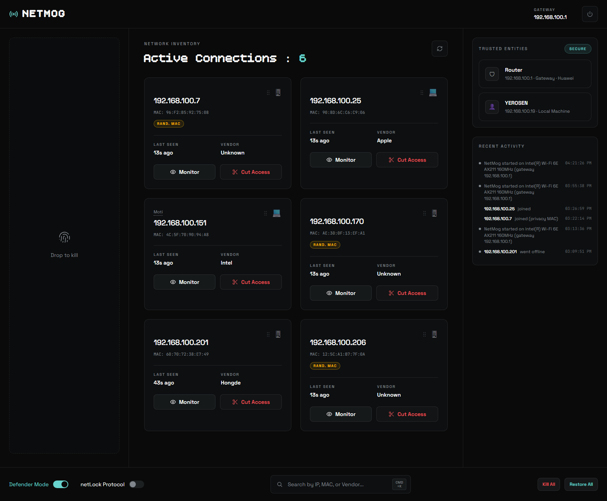

# NetMog

**See every device on your LAN, cut off the ones that shouldn't be there, and watch exactly how much bandwidth each one is using.**

NetMog is a Windows network controller in the spirit of NetCut, rebuilt as a self-contained app with a local browser UI. It discovers the machines on your network, identifies them by hardware address (so a DHCP change can't hide a device), poisons their ARP entry to cut them off, and relays a device's traffic when you ask it to measure or cap its speed.



> [!WARNING]
> **Use NetMog only on networks you own or are responsible for administering.**
> It works by answering ARP requests on other people's behalf — that is a man-in-the-middle position. Pointing it at a network you do not control (a school, an office, a café, a neighbour's Wi-Fi) is illegal in most countries and is a quick way to get yourself banned or prosecuted. Everything else in this README assumes you have permission.

---

## Contents

- [What it does](#what-it-does)
- [Requirements](#requirements)
- [Install](#install)
- [First run](#first-run)
- [Using NetMog](#using-netmog)
- [How it works](#how-it-works)
- [Troubleshooting](#troubleshooting)
- [Build from source](#build-from-source)
- [Project layout](#project-layout)
- [Local HTTP API](#local-http-api)
- [Your data](#your-data)
- [License](#license)

---

## What it does

| Feature | What it means |
|---|---|
| **Device inventory** | Every IP/MAC on the local subnet, refreshed automatically every 15 seconds and on demand. |
| **Vendor detection** | The MAC's OUI is matched against a built-in vendor table (Apple, Samsung, TP-Link, …). Phones using a randomized MAC are labelled as such instead of being guessed at. |
| **Device names** | NetMog asks for each device's name over the Windows resolver, NetBIOS and mDNS, and shows what it finds (`Moti`, `YEROSEN`, `Living-Room-TV`). Names are cached per MAC. |
| **Cut / restore** | Cuts a device's access by poisoning its ARP entry with the gateway (and the gateway's entry for the device) while dropping its frames. Restore puts the entries back immediately. |
| **Kill All / Restore All** | One click for the whole LAN. Your own machine and the gateway are never cut. |
| **netLock** | Arm it and everything currently on the network is approved; devices that appear afterwards are cut automatically. Devices with a rotating privacy MAC are flagged `Rand. MAC`, not cut, so a phone doesn't get disconnected just for rotating its address. Survives restarts. |
| **Defender mode** | On by default. Continuously re-asserts your machine's ARP identity, so another cutter (or a second copy of NetMog) can't keep you offline. |
| **Bandwidth monitor** | Routes a device's traffic through your machine, measures download/upload live, and draws a 16-second sparkline. |
| **Bandwidth limit** | Cap that device at *N* kbps. Enforced by dropping frames as they cross the relay, so TCP backs off and the link still works instead of dying. |
| **Activity log** | A persisted, timestamped record of joins, leaves, cuts, restores, limits and netLock decisions, with the device name attached (`Moti · cut access`). |
| **Labels** | Right-click any card → **Name this device**. Labels are per MAC, persist across restarts, and never change a device's trust state. |
| **Search** | Filter the inventory by IP, MAC or vendor (<kbd>Ctrl</kbd>+<kbd>K</kbd>). |
| **Clean exit** | Quitting restores every cut device. If the process dies anyway, the next launch restores whatever it left cut. |

NetMog is IPv4-only, Windows-only, and controls access to the **local network segment** — it is not a router, a firewall, or a parental-control tool, and it cannot reach devices behind another router.

---

## Requirements

| | |
|---|---|
| OS | Windows 10 (1809 or newer) or Windows 11, **x64** |
| Privileges | Administrator (required to send raw packets — NetMog asks for it on launch) |
| Driver | [Npcap](https://npcap.com/#download) with **"Install Npcap in WinPcap API-compatible Mode"** checked, or the legacy WinPcap 4.1.3 |
| Network | One active adapter with a gateway on an Ethernet/Wi-Fi LAN, IPv4 |
| Runtime | None — the release build is self-contained |

Npcap is not bundled: its free licence does not allow redistributing the installer. Download it from [npcap.com](https://npcap.com/#download) — during setup, tick *Install Npcap in WinPcap API-compatible Mode*. Without it NetMog tells you and exits.

---

## Install

### Prebuilt (recommended)

1. Download `NetMog_v1.0.0_portable.zip` from the [Releases](https://github.com/yerosentamrat63/NetMog/releases) page.
2. Extract it anywhere — `C:\Tools\NetMog` or your Desktop is fine. There is no install step; `NetMog.exe` is the whole app.
3. Double-click `NetMog.exe`. Windows asks for administrator rights; accept.

Windows will show **"Windows protected your PC"** the first time, because the executable is not code-signed. Click **More info → Run anyway**. If your antivirus quarantines it, that is a false positive caused by the ARP-spoofing behaviour the app is built on — exclude the folder if you trust the source (this repo).

**Prefer an installer?** `NetMog_Setup_v1.0.0.exe` sits next to the zip on the same Releases page. It installs to `Program Files\NetMog`, adds Start-menu and optional desktop shortcuts, and registers an uninstaller. It still does not bundle Npcap — setup offers to open npcap.com when the driver is missing.

### From source

```powershell
git clone https://github.com/yerosentamrat63/NetMog.git
cd NetMog
dotnet build NetMog/NetMog.csproj -c Debug
```

Requires the [.NET 8 SDK](https://dotnet.microsoft.com/download/dotnet/8.0). Run the built `NetMog\bin\Debug\net8.0-windows\NetMog.exe` as administrator.

---

## First run

1. NetMog checks for the pcap driver, picks the adapter that has your default gateway, and starts a web server on **`127.0.0.1`, first free port from 8899 to 8918**.
2. Your browser opens automatically. The chosen port is remembered in `%LOCALAPPDATA%\NetMog\port.txt`, so clicking `NetMog.exe` again while it is running just reopens the UI (single instance).
3. Devices appear within a couple of seconds. The first scan is a full ARP sweep of the subnet; later scans are incremental.
4. Closing the browser tab does **not** stop NetMog. Use the power button in the top-right of the UI to quit — that restores every device first.

---

## Using NetMog

**Cards.** Each device gets a card in the middle grid: name, IP, MAC, vendor, last seen. Your own machine and the gateway live in the **TRUSTED ENTITIES** rail on the right and cannot be cut.

**Actions.** Right-click a card for:

| Item | Effect |
|---|---|
| Cut device / Restore device | Cuts or restores that one device. |
| Monitor bandwidth | Opens the live download/upload panel for that device. |
| Name this device | Opens the naming dialog. Type a label, press <kbd>Enter</kbd>. Clearing the field removes the label and falls back to the detected name. **A label is only a label — it does not trust the device.** |

**Dragging** a card into the left **"Drop to kill"** zone is the fastest way to cut it; cut devices pile up there until you restore them.

**Bottom bar.**

- **Defender Mode** — keep your own link alive against other ARP cutters. Leave it on.
- **netLock Protocol** — auto-cut unknown devices (see below).
- **Search** — filter by IP, MAC or vendor.
- **Kill All / Restore All** — the whole LAN at once.

**Bandwidth panel.** While monitoring, the dialog shows current and peak download/upload, a 16-second sparkline, the running total, and how many frames were dropped. Set a limit in **kbps** and press **Apply** (`0` or empty = unlimited). Limits are stored per MAC and re-applied as soon as you monitor that device again. Two things to know before relying on it:

- Traffic only flows through your machine while that device is being monitored, so the cap applies only during monitoring.
- A hard cap is enforced by packet loss. Video calls will glitch at very low limits; that is the throttle working.

**netLock.** Arming it snapshots everything currently online as approved. From then on, a device that appears **and stays** (3 scans, so a brief DHCP blip doesn't trigger it) is cut unless it is approved. Approve a device by restoring it. Privacy-MAC devices are flagged with a note instead of being cut. The approved list and the armed state persist across restarts, so a reboot doesn't unlock the network. Turning netLock off stops new cuts but does not restore anything already cut.

**Activity log.** The right-hand **RECENT ACTIVITY** panel shows the last 30 events and keeps 500 in memory. Everything is also appended to `history.jsonl`, so the log survives a restart.

**Quitting.** Power button → NetMog restores every cut device, stops the meter and exits. If you have to kill it from Task Manager, the next launch restores anything left cut.

---

## How it works

NetMog opens the active adapter with SharpPcap and talks raw ARP:

- **Discovery** — an ARP sweep of the subnet; the OS ARP table fills in the rest. Devices are keyed by **MAC**, so names, cuts, limits and history follow the hardware across DHCP leases.
- **Cutting** — for a victim `V` and gateway `G`, NetMog tells `V` that `G` is at NetMog's MAC and tells `G` that `V` is at NetMog's MAC, re-sending on a fast timer so neither cache expires. Frames from `V` are then dropped instead of forwarded, so `V` loses the LAN and the internet while the rest of the network is unaffected.
- **Monitoring** — the same position, except frames are forwarded: IPv4 packets are relayed at layer 2 (TTL decremented, checksum recomputed, Ethernet addresses rewritten) and counted per direction. That is how the meter sees real traffic without breaking the connection.
- **Limiting** — a token bucket on the relay drops frames once the budget is spent.
- **Naming** — `Dns.GetHostEntry` first (this covers DNS, LLMNR and mDNS), then a direct NetBIOS name query, then a direct mDNS reverse lookup. Slow lookups run off the scan thread and give up after 6 attempts per MAC.
- **Defender** — keeps re-announcing your own IP/MAC pair to the gateway so a competing poisoner's entries get overwritten.

The UI is plain HTML/CSS/JS served from an embedded resource — no Electron, no Node, no bundled browser. The executable is ~70 MB because it carries the .NET runtime.

---

## Troubleshooting

| Symptom | Cause / fix |
|---|---|
| **"Administrator required"** | Launch `NetMog.exe` directly (not from a non-elevated terminal). UAC must be accepted. |
| **"pcap library missing"** | Install Npcap with *WinPcap API-compatible Mode*, or WinPcap 4.1.3. Reboot is not needed, but restart NetMog. |
| **"No pcap device matches the active network adapter"** | A VPN, Hyper-V or VirtualBox virtual adapter is holding the default route, or the adapter was just reconnected. Disconnect the VPN / disable the virtual adapter and restart NetMog. |
| **"No active network adapter with a gateway was found"** | You are offline, or the connection has no default gateway (e.g. a direct cable to another PC). |
| **Browser opens to a blank page** | The port file is stale from a crash. Quit any running copy, delete `%LOCALAPPDATA%\NetMog\port.txt`, relaunch. |
| **Nothing happens when it says "could not find a free port"** | Something holds 8899–8918. Close it and retry. |
| **A device's name is blank** | It announces no name over DNS/LLMNR/NetBIOS/mDNS (common for routers and phones with private MACs). Right-click → *Name this device* to label it; the label sticks to the MAC. |
| **A cut device stays offline after "Restore"** | Its ARP cache can take up to a minute to expire. If it was cut by netLock, restoring also approves it. Reconnecting its Wi-Fi forces a fresh ARP immediately. |
| **The device I cut can still reach the internet** | It is on another segment, behind its own router, or using IPv6 (NetMog only controls IPv4 ARP on your own LAN). |
| **"some devices are missing"** | They are on a different subnet/VLAN or asleep. Wired and wireless clients on the same SSID should all appear. |
| **Kill All hit a device I wanted online** | Restore it. Restoring is also how you approve it for netLock. |
| **Windows Defender / SmartScreen blocks the exe** | Unsigned hobby build. *More info → Run anyway*, or add an exclusion after checking the source yourself. |

If NetMog misbehaves badly, run **Restore All** before quitting, and delete `%LOCALAPPDATA%\NetMog\pending-restores.json` only if you are certain nothing is cut — that file is what makes a crashed session self-heal.

---

## Build from source

Requirements: .NET 8 SDK, Windows, and (for the installer) [Inno Setup 6.3 or newer](https://jrsoftware.org/isdl.php).

```powershell
# Publish a self-contained single-file exe + build the distributable zip
powershell -ExecutionPolicy Bypass -File build-installer.ps1

# Everything lands in dist\
#   NetMog_v1.0.0_portable.zip        <- what friends download
#   NetMog_Setup_v1.0.0.exe           <- optional installer (only if ISCC.exe is found)
```

The script:

1. publishes `NetMog/NetMog.csproj` for `win-x64`, self-contained, single file, into `bin/publish/`;
2. zips the executable with a short quickstart into `dist/NetMog_v<version>_portable.zip`;
3. compiles `installer/setup.iss` into `dist/`, passing the version from `NetMog.csproj` so the two never drift apart.

The version lives in one place: `<Version>` in `NetMog/NetMog.csproj`. It is reported by the app (`/api/info`), stamped into the exe properties, and handed to the installer.

---

## Project layout

```
NetMog/
  Program.cs            entry point: single instance, admin + driver checks, port pick, browser
  app.manifest          requireAdministrator
  WebServer.cs          HttpListener on 127.0.0.1, serves the UI + JSON API
  DeviceManager.cs      device state, netLock trust, persisted names/limits/history
  Core/
    ArpScanner.cs       subnet sweep + ARP table read
    ArpPoisoner.cs      cut/restore, defender mode, frame capture
    TrafficMeter.cs     relay + per-device byte counters + kbps limiter
    ArpWinApi.cs        IP Helper API wrappers (SendARP, GetIpNetTable)
    NetworkInfo.cs      adapter/gateway/MAC discovery
    MdnsResolver.cs     mDNS reverse lookup + name cleanup
    NetbiosResolver.cs  NetBIOS name query
    MacVendor.cs        OUI vendor lookup + randomized-MAC detection
    OuiData.cs          embedded vendor prefix table
    EventLog.cs         in-memory ring buffer + history.jsonl
  Models/
    DeviceInfo.cs       one device
    NetMogEvent.cs      one activity-log row
  web/                  index.html, app.js, style.css (embedded resources)
installer/setup.iss     Inno Setup script
installer/notice.txt    shown before installation
build-installer.ps1     publish + zip + installer
docs/screenshot.png     the image at the top of this README
dist/                   build output (git-ignored)
```

---

## Local HTTP API

The UI is a normal web app over a JSON API, so anything you can click you can also script. Every endpoint is bound to **127.0.0.1** and POSTs must be `Content-Type: application/json` from the UI's own origin — a random website you visit cannot cut your LAN.

| Method | Path | Body | Returns |
|---|---|---|---|
| GET | `/api/info` | — | adapter, local IP, gateway, MACs, version |
| GET | `/api/devices` | — | devices, recent events, scanning/netLock/defender/meter state |
| GET | `/api/history?limit=100` | — | the last `limit` events |
| POST | `/api/scan` | — | `{ ok }` — starts a scan |
| POST | `/api/kill` | `{ "ip": "192.168.1.20" }` | `{ ok }` |
| POST | `/api/restore` | `{ "ip": "..." }` | `{ ok }` (also approves it for netLock) |
| POST | `/api/killall` | — | `{ ok, count }` |
| POST | `/api/restoreall` | — | `{ ok, count }` |
| POST | `/api/monitor` | `{ "ip": "..." }` | `{ ok, metering }` — toggles monitoring |
| POST | `/api/monitorstop` | — | `{ ok }` |
| POST | `/api/limit` | `{ "ip": "...", "kbps": 500 }` | `{ ok }` — `0` removes the limit |
| POST | `/api/defender` | `{ "on": true }` | `{ ok, on }` |
| POST | `/api/netlock` | `{ "on": true }` | `{ ok, on }` |
| POST | `/api/rename` | `{ "mac": "AA:BB:...", "name": "TV" }` | `{ ok }` |
| POST | `/api/shutdown` | — | `{ ok }` — restores everything and quits |

```powershell
$port = Get-Content "$env:LOCALAPPDATA\NetMog\port.txt"
curl "http://127.0.0.1:$port/api/devices"
curl -X POST "http://127.0.0.1:$port/api/kill" -H "Content-Type: application/json" -d '{\"ip\":\"192.168.1.20\"}'
```

---

## Your data

Everything is stored in `%LOCALAPPDATA%\NetMog\` and never leaves the machine:

| File | Contents |
|---|---|
| `port.txt` | the port the UI is on |
| `device-names.json` | your labels, keyed by MAC |
| `trusted-devices.json` | netLock approved MACs/names + whether it is armed |
| `limits.json` | per-MAC bandwidth limits |
| `seen-devices.json` | devices that have been reported as new once |
| `pending-restores.json` | devices still cut, so a crash can be undone on next launch |
| `history.jsonl` | activity log (compacted at 1 MiB) |

There is no telemetry, no account, no update check. The only outbound request the app makes is the one your browser makes for the web fonts referenced by `web/index.html`; with no internet the UI falls back to system fonts and everything still works.

To remove NetMog completely: uninstall it (if you used the installer), delete the extracted folder, then delete `%LOCALAPPDATA%\NetMog`.

---

## License

MIT — see [LICENSE](LICENSE). Npcap is not included and is governed by its own licence; you install it yourself from npcap.com.

NetMog is provided as-is, with no warranty. You are responsible for how you use it: only on networks you own or are authorised to administer.
